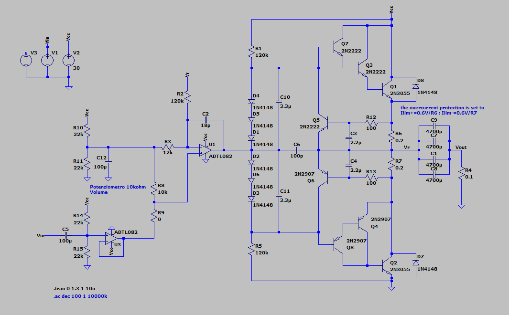
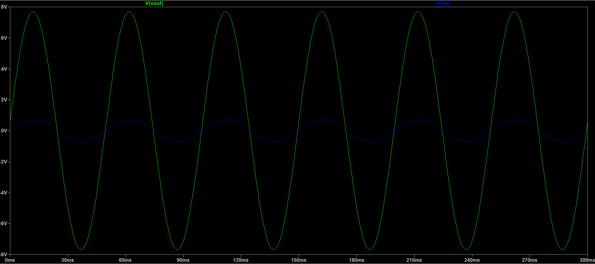
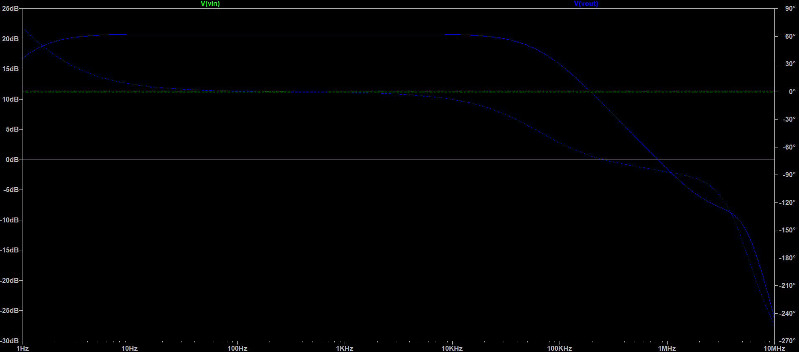
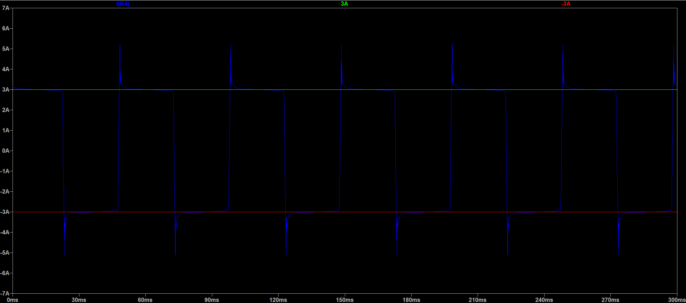
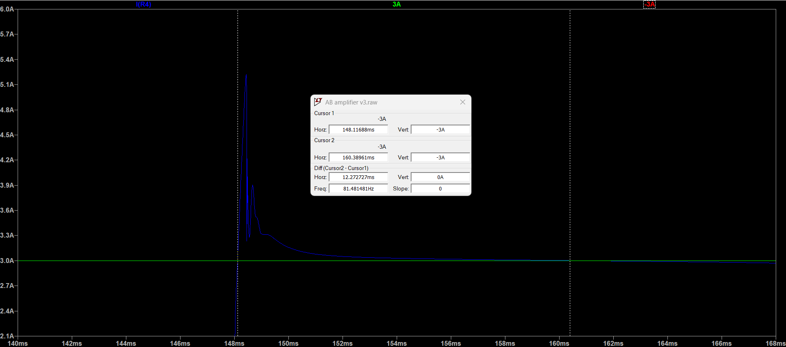

# Class-AB Audio Power Amplifier

<p align="left">
  
  
  
</p>

## Overview

Design and simulation of a **Class-AB audio power amplifier**, focusing on output-stage linearity, crossover distortion reduction, and overcurrent protection.

The circuit combines an input amplification stage, diode-based biasing, and a complementary power output stage to achieve linear signal amplification. LTspice simulations are used to investigate the amplifier's transient response, frequency behavior, and current-limiting operation.

The project also explores the interaction between output-stage biasing, load current, and protection circuitry.

## Design Calculations



### 1. Power-Supply Smoothing Capacitor

The required smoothing capacitance is estimated using the empirical relationship for a full-wave rectifier:

$$
C \simeq \frac{I_{\mathrm{load}}}{2f \cdot \Delta V}
$$

where:
- $I_{\mathrm{load}}$ is the maximum load current.
- $f$ is the AC supply frequency.
- $\Delta V$ is the maximum allowable peak-to-peak ripple voltage.

Assuming a maximum load current of 3A, limited by the BJT-based output protection circuit, and a maximum ripple voltage of 2V, the required capacitance is approximately 15mF, assuming a 50Hz AC supply.

The implemented solution uses five 4700 $\mu$F capacitors connected in parallel, providing a nominal total capacitance of:

$$
C_{\mathrm{total}} = 5 \times 4700\,\mu\mathrm{F}
= 23.5\,\mathrm{mF}
$$

This capacitance exceeds the theoretical minimum and provides additional margin for smoothing the rectified voltage under load.

### 2. Output Current-Limit Protection

The positive and negative output-current limits are set by the current-sensing resistors $R_6$ and $R_7$. Using the approximate base-emitter voltage of a BJT, $V_{BE}\simeq 0.6\mathrm{V}$, the limiting currents can be estimated as:

$$
I_{\mathrm{max}+} \simeq \frac{0.6\,\mathrm{V}}{R_6}
$$

$$
I_{\mathrm{max}-} \simeq -\frac{0.6\,\mathrm{V}}{R_7}
$$

For a nominal current limit of approximately $\pm 3\mathrm{A}$, the required resistance values are:

$$
R_6 \simeq R_7 \simeq
\frac{0.6\,\mathrm{V}}{3\,\mathrm{A}}
= 0.2\,\Omega
$$

Using equal sensing resistances provides approximately symmetrical positive and negative current limits. The actual thresholds may differ due to transistor characteristics, temperature, and resistor tolerances.

### 3. Volume Control

Resistors $R_8$ and $R_9$ represent the upper and lower portions of a $10\mathrm{k}\Omega$ potentiometer used to adjust the amplifier's input level.

Rotating the potentiometer changes the voltage delivered to the following amplification stage, thereby controlling the audio volume.

## Simulation Results

### 1. Transient Response

The transient simulation compares the input signal \(V_{in}\) with the output signal \(V_{out}\).

The output waveform demonstrates the amplifier's ability to reproduce the input sinusoid with increased amplitude. The region around the zero crossing is particularly relevant for evaluating crossover distortion in the Class-AB output stage.



### 2. Frequency Response

The Bode plot shows the output-to-input transfer function in terms of gain magnitude and phase.

The simulated response exhibits a relatively flat passband up to approximately **100 kHz**, followed by high-frequency attenuation. The magnitude and phase responses provide insight into the amplifier's bandwidth and frequency-dependent behavior.



### 3. Output Current Limiting

The current-limit simulation evaluates the behavior of the protection circuit under excessive output-current demand.

The circuit is designed to constrain the load current to approximately **±3 A**, helping protect the output transistors against overload conditions.



### 4. Current-Limit Transient Response

A closer view of the transient response highlights the behavior of the protection circuit during a current-limit event.

The simulation shows the current transient settling toward the intended limiting level. The observed settling time is approximately **12 ms** under the simulated conditions.



## Repository Structure

```text
.
├── README.md                               # Project documentation
├── img/                                    # Images and simulation results
├── KiCad/                                  # Schematics and PCB designs
│   └── mono_amplifier/
│       ├── AB_amp/                         # Class-AB amplifier design
│       ├── audio equalizer/                # Audio equalizer design
│       ├── mono_amplifier/                 # Main KiCad project — open this project only;
│       │                                   # the other designs are internally linked
│       └── power supply/                   # Power supply design
└── Spice/                                  # LTspice simulations
    └── opamp version/
        ├── AB amplifier final version.asc  # Final amplifier simulation
        ├── AB amplifier v1.asc             # Amplifier simulation, version 1
        ├── AB amplifier v2.asc             # Amplifier simulation, version 2
        └── AB amplifier v3.asc             # Amplifier simulation, version 3
```

> **Important:** Open only the main KiCad project file: `KiCad/mono_amplifier/mono_amplifier/mono_amplifier.kicad_pro`. The other KiCad designs are internally linked to this project.